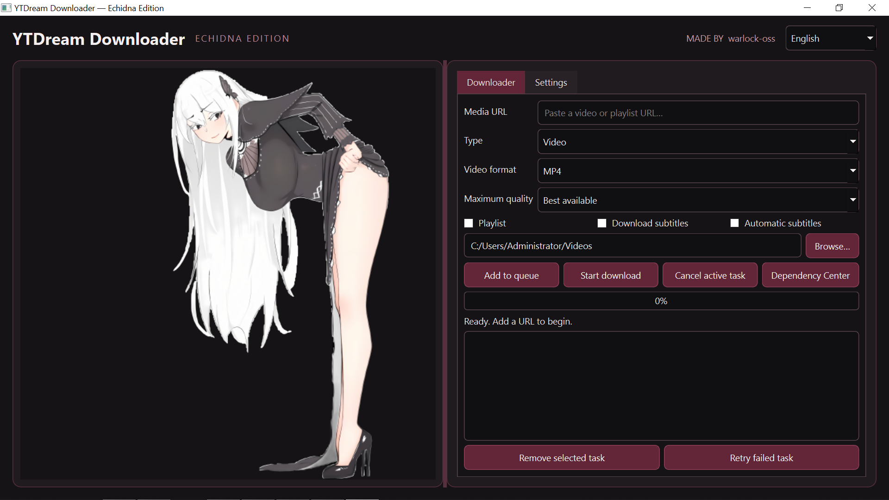

# YTDream Downloader — Echidna Edition

**A desktop video downloader built with Python and PySide6.**

# YTDream Downloader — Echidna Edition

A Windows desktop media downloader built with Python, PySide6, and yt-dlp. Created by **warlock-oss**.

## Application Preview

  

## Features
- Gothic-inspired dark UI with equal-width mascot and feature panels.
- Video downloads, MP3 audio extraction, subtitle options, playlist support, and a sequential task queue.
- Dependency Center for environment checks, Python package setup, and optional FFmpeg download.
- User-level settings and rotating logs.
- Development scripts and a PyInstaller onedir build script.

## Requirements
- Windows 10/11 x64 for the supplied batch scripts and Windows build.
- Python 3.10–3.13 for source development. Python 3.12 is preferred by `setup.bat`.
- Internet access for package setup and media downloads. FFmpeg is needed for audio extraction and merging separate streams.

## Development setup
1. Install a compatible Python version from the official Python distribution.
2. Open this folder in VS Code.
3. Run `scripts\setup.bat`. This creates `.venv` and installs the project dependencies into it.
4. Run `scripts\run.bat`, or use the included VS Code Run and Debug configuration.

Do not run setup against a Python installation you need to keep untouched; the script creates a project-local virtual environment.

## Build
Run `scripts\build.bat` on Windows. The initial build uses PyInstaller `--onedir` for easier diagnostics and more reliable resource handling. Output is expected under `dist\YTDream-Downloader\`. A build is not considered release-ready until tested on a clean Windows machine.

## Executable usage
Launch `YTDream-Downloader.exe` from the output folder. Python is not required on the target machine when packaging succeeds. The current project does not include a signed installer.

## Dependency Center
The Dependency Center checks Python, PySide6, yt-dlp, FFmpeg, FFprobe, and resource availability. In source mode, package installation is deliberately restricted to a virtual environment. FFmpeg download uses the BtbN FFmpeg Builds GitHub release over HTTPS. Release assets may not provide a checksum, so cryptographic integrity cannot be guaranteed in that case; inspect the release provenance before production deployment.

Bundled dependencies in a frozen executable are not to be reinstalled by default. The FFmpeg installer currently targets Windows only.

## Configuration and logs
Settings are stored using the platform's application configuration directory (typically under the user's AppData profile). Logs are written to `%LOCALAPPDATA%\YTDreamDownloader\logs\ytdream.log` where available.

## Tests
Install development dependencies and run `python -m pytest`. Tests use no live downloads and do not install system dependencies.

## Troubleshooting
- If the GUI fails to launch, run from `scripts\run.bat` and inspect the log file.
- If MP3 extraction or separate audio/video merging fails, install FFmpeg from the Dependency Center.
- If package installation is blocked, ensure the app is running from the project `.venv`.
- If the mascot is missing, place the original transparent PNG at `assets/images/echidna.png`. The application displays a neutral placeholder otherwise.

## Responsible use
Only download media you own, have permission to download, or that is otherwise legally available for download. Respect applicable law and the service's terms. Never disable antivirus or Windows security controls to run this application.

## License and credits
Created by **warlock-oss**. No license has been selected yet; all rights are reserved by default until the project owner chooses and adds a license. Third-party components retain their own licenses.

## Known limitations
- Quality selection is a maximum-height preference; it cannot create quality absent from the source.
- Playlist item selection is not yet implemented; the playlist option downloads the supported playlist as a whole.
- The queue processes one task at a time.
- The first version does not provide an installer package or signed executable.
- Dependency checks and build scripts require Windows-specific validation before release.

## FFmpeg detection troubleshooting

The Dependency Center checks the configured FFmpeg location first, followed by the app's `tools/ffmpeg` folder, `C:\Tools\ffmpeg`, common extracted `Downloads\ffmpeg*\bin` folders, and `PATH`. The configured location may be either the folder containing `ffmpeg.exe` and `ffprobe.exe`, or the path to `ffmpeg.exe` itself. Use **Periksa Ulang** after changing the location.

The automatic Windows installer selects a compatible ZIP asset from the latest BtbN FFmpeg release instead of assuming the archive is named `win64-gpl-essentials.zip` (that naming is associated with other build providers).

Place your original mascot image at `assets/images/echidna.png`; the image is not redistributed in this source archive unless you add your own asset.
